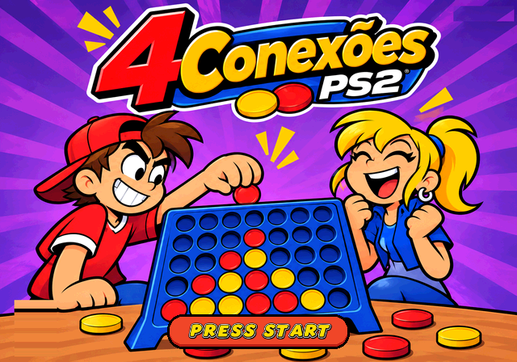
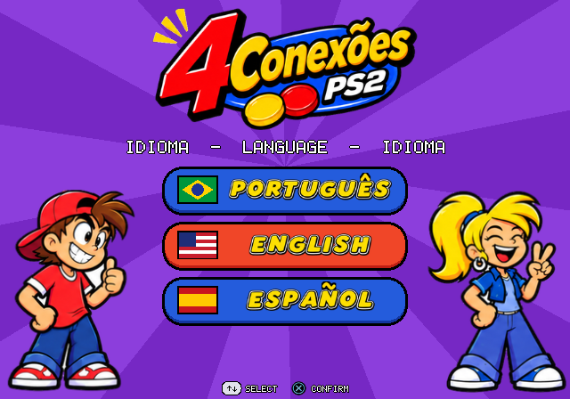
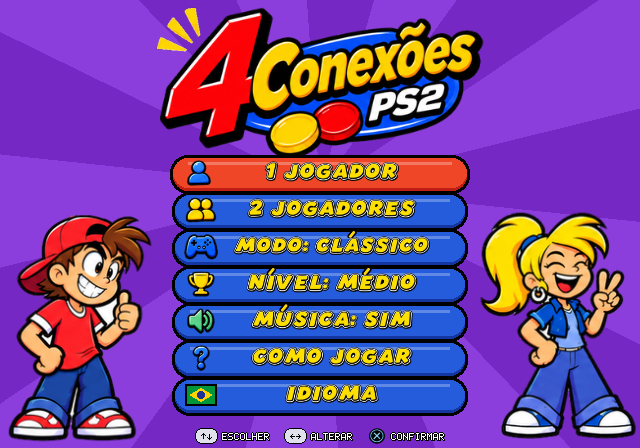
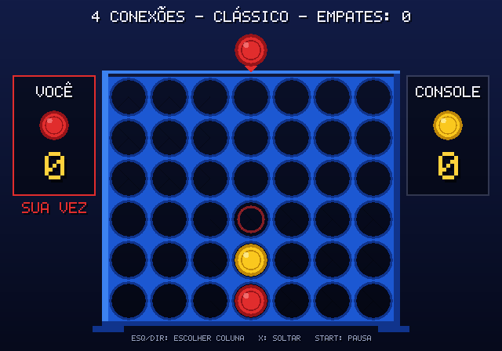
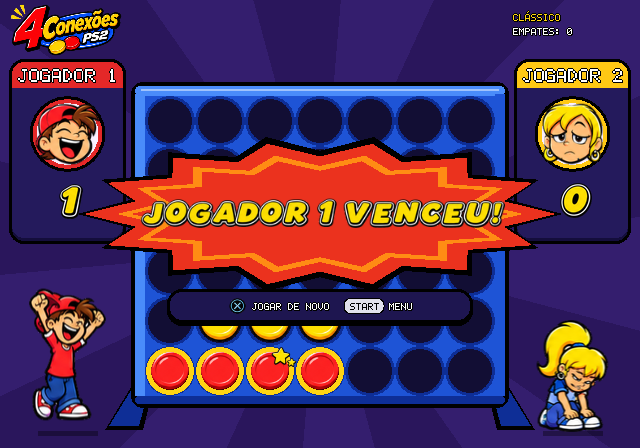
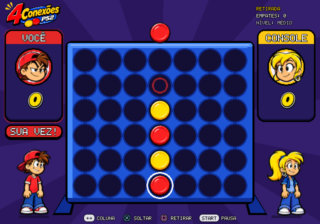
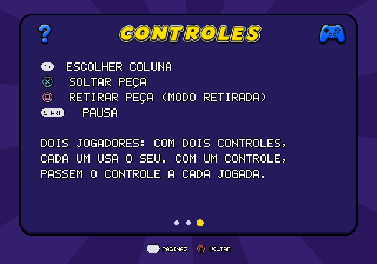
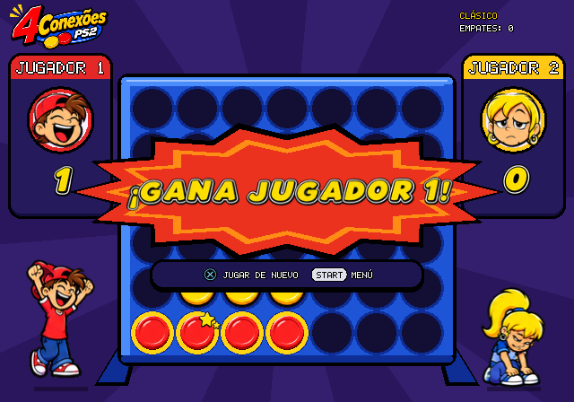
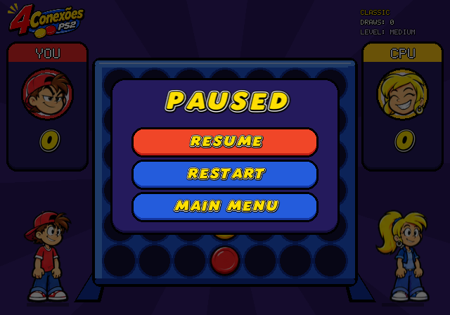

# 4 Conexões (PlayStation 2)

Jogo de estratégia para PlayStation 2 em que dois jogadores tentam alinhar quatro peças numa grade vertical. Usa as mecânicas do clássico "ligue 4" (Connect 4, da Hasbro), com arte, código e nome próprios.

| Abertura | Idioma | Menu |
|---|---|---|
|  |  |  |

## Regras

Regras clássicas pesquisadas nas instruções do jogo original:

- A grade vertical tem **7 colunas e 6 linhas**.
- Cada jogador usa uma cor: **vermelho** (jogador 1) ou **amarelo** (jogador 2).
- Na sua vez, o jogador solta **uma peça** numa coluna. A peça cai até a casa livre mais baixa.
- Vence quem formar primeiro **4 peças da sua cor em linha**: na horizontal, na vertical ou na diagonal.
- Se a grade encher sem nenhuma linha de 4, a partida termina **empatada**.
- Não dá para jogar numa coluna cheia.
- O vermelho começa a primeira partida. Nas seguintes, quem começa alterna.

### Modo Retirada (variante "Pop Out")

A caixa do jogo original traz modos extras. O 4 Conexões tem um baseado no *Pop Out*:

- Na sua vez, você pode **soltar** uma peça ou **retirar** uma peça **sua** da linha de baixo. As peças daquela coluna descem uma casa.
- Se uma retirada formar 4 em linha para os dois jogadores ao mesmo tempo, **vence quem retirou**.
- Se uma retirada completar só a linha do adversário, vence o adversário.
- Regra da casa, para impedir partidas infinitas: a partida termina empatada se o jogador da vez não tiver nenhuma jogada válida ou depois de 120 jogadas.

| Partida | Vitória | Modo Retirada |
|---|---|---|
|  |  |  |
| **Como jogar** | **Español** | **English** |
|  |  |  |

## Recursos

- **Três idiomas: Português, Inglês e Espanhol.** O idioma é escolhido logo depois da tela de abertura e pode ser trocado no menu.
- **Personagens:** o jogador 1 (vermelho) é o garoto de boné e o jogador 2 (amarelo) é a garota de rabo de cavalo. Os retratos mudam de expressão durante a partida (concentração, surpresa, comemoração, tristeza) e as poses de corpo inteiro reagem à vitória, à derrota e ao console "pensando".
- Interface no estilo cartum feita com as sprites do projeto: logotipo, fonte amarela com contorno, peças, ícones e botões do controle.
- **Músicas e efeitos sonoros** originais em estilo chiptune, sintetizados em tempo real: tema do menu, tema da partida, vinhetas de vitória, derrota e empate, e efeitos para cursor, menus, peça caindo e encaixando, retirada, jogada inválida e pausa. A música pode ser desligada no menu.
- **1 jogador contra o console**, com três níveis: Fácil, Médio e Difícil. A IA usa busca minimax com poda alfa-beta.
- **2 jogadores**. Com dois controles conectados, cada jogador usa o seu. Com um só, os dois revezam o mesmo controle.
- Placar de vitórias e empates durante a sessão.
- Animação da peça caindo (com quique) e da retirada.
- Prévia da casa onde a peça vai cair. A linha vencedora pisca no fim da partida.
- Tela "Como jogar" com regras e controles, nos três idiomas e com acentos (incluindo Ñ, ¡ e ¿).
- Funciona em NTSC e PAL: o layout se ajusta à resolução.

## Controles

| Botão | Ação |
|---|---|
| Direcional ← → | Escolher coluna / alterar opção |
| Direcional ↑ ↓ | Navegar nos menus |
| ✕ (X) | Soltar peça / confirmar |
| □ (Quadrado) | Retirar peça (Modo Retirada) |
| ○ (Círculo) | Voltar |
| START | Pausar (continuar, reiniciar, menu) |

## Estrutura do projeto

```
src/
  board.c/h          regras: gravidade, turnos, vitória, empate, retirada
  ai.c/h             adversário: negamax com poda alfa-beta
  font.c/h           fonte bitmap 5x7 com acentos (UTF-8)
  bigfont.c/h        fonte grande recortada da arte (títulos e botões)
  lang.c/h           textos em Português, Inglês e Espanhol
  audio.c/h          sintetizador: músicas (notação própria) e efeitos
  irx_ps2.c          audsrv.irx do PS2SDK embutido no ELF
  assets.c/h         tabelas das sprites (gerado por tools/make_assets.py)
  game.c/h           telas, menus, animações e desenho
  platform.h         interface de vídeo e controles
  platform_ps2.c     implementação para PS2 (gsKit + libpad)
  main_ps2.c         ponto de entrada no PS2
host/                versão para PC (renderização por software) usada em
                     testes e capturas de tela
tests/test_board.c   testes de regras e IA
assets/src/          folhas de arte originais (capa, personagens, interface, fonte)
assets/assets.pak    pixels das sprites, já no formato do GS (embutido no ELF)
tools/make_assets.py recorta as folhas, remove o fundo e gera o .pak
```

### Recursos gráficos

As sprites são recortadas das folhas em `assets/src/`. O script remove o fundo branco, redimensiona as imagens e gera `assets/assets.pak` + `src/assets.c/h`. Os arquivos gerados já estão no repositório; só é preciso rodar o script de novo se a arte mudar:

```sh
pip install pillow numpy scipy
python3 tools/make_assets.py
```

No PS2, as texturas ficam na RAM e o gerenciador de texturas do gsKit as envia para a VRAM conforme o uso. A capa usa 16 bits por pixel e as demais sprites, 32 bits com transparência.

A lógica (`board`, `ai`, `game`, `font`) não depende do hardware. Toda a parte específica do PS2 fica em `platform_ps2.c`.

## Áudio

O som é gerado pelo próprio jogo, sem arquivos de áudio. O sintetizador em `src/audio.c` tem quatro canais de música e seis vozes de efeitos:

- **Melodia:** onda quadrada com vibrato.
- **Harmonia:** arpejos em onda quadrada fina.
- **Baixo:** onda triangular.
- **Bateria:** bumbo, caixa e chimbal feitos de seno e ruído.

As músicas são composições originais, escritas numa notação de texto no próprio código (uma semicolcheia por token). No PS2, o jogo gera PCM mono a 22 050 Hz e o envia ao módulo `audsrv`, que fica embutido no ELF. Quando o console vai pensar, o buffer de áudio é preenchido inteiro para a música não cortar.

## Download

As versões prontas ficam em **Releases**. Para publicar uma nova versão, use uma destas opções:

- Envie uma tag `v*` (por exemplo, `git tag v1.1.0 && git push origin v1.1.0`).
- Em **Actions → Build → Run workflow**, preencha o campo "versao" (por exemplo, `v1.1.0`).

Nos dois casos, o GitHub Actions roda os testes, compila o ELF, cria a tag e publica a release com `4conexoes.elf` e um `.zip`.

## Compilação

### PlayStation 2

É preciso ter o [PS2SDK](https://github.com/ps2dev/ps2dev) com gsKit. O jeito mais simples é a imagem Docker oficial:

```sh
docker run --rm -v "$PWD":/src -w /src ps2dev/ps2dev:latest \
  sh -c "apk add --no-cache build-base && make"
```

O comando gera o `4conexoes.elf`. `make packed` gera uma versão comprimida com `ps2-packer`.

Toda vez que há um push, o GitHub Actions (`.github/workflows/build.yml`) compila o ELF e o publica como artefato `4conexoes-ps2`.

### Como rodar

- **Emulador:** no PCSX2, use *Sistema → Executar ELF* e escolha `4conexoes.elf`.
- **Console:** copie o ELF para um pendrive e abra pelo uLaunchELF (via FreeMcBoot, por exemplo).
- **ps2link:** `make run`, que usa `ps2client`.

### Testes no PC

```sh
make -f Makefile.host test   # testes de regras, IA e áudio
make -f Makefile.host host   # versão PC para gerar capturas
./4conexoes_host DX X w30 shot:tela.ppm
```

O executável do PC aceita comandos de controle: `L R U D X O Q T S`, `w<N>` para esperar N quadros, `shot:<arquivo>` para salvar a tela em PPM e `wav:<arquivo>` para salvar o áudio gerado. `./tests/test_audio <pasta>` grava cada música e efeito em WAV.

---

*Connect 4 é marca registrada da Hasbro. Este é um projeto de fã, independente, sem nenhuma afiliação com a Hasbro.*
